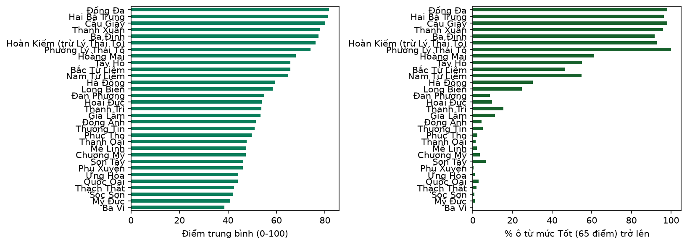
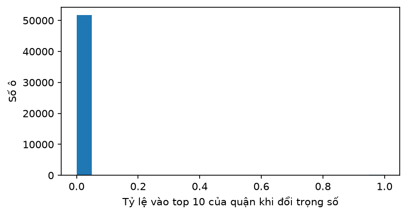

# ỨNG DỤNG GIS VÀ PHƯƠNG PHÁP RA QUYẾT ĐỊNH ĐA TIÊU CHÍ (AHP) ĐỂ LỰA CHỌN VỊ TRÍ TRẠM SẠC XE ĐIỆN TẠI HÀ NỘI

**Môn học:** Hệ thống thông tin không gian GIS
**Học viên/Sinh viên:** [Họ và tên]
**Mã số:** [MSSV]
**Giảng viên hướng dẫn:** [Họ và tên]
**Đơn vị:** [Khoa/Bộ môn]
**Năm học:** 2026 – 2027

---

## Tóm tắt

Nghiên cứu này xây dựng một quy trình đánh giá và lựa chọn vị trí tiềm năng cho trạm sạc xe điện trên phạm vi Hà Nội bằng công cụ hệ thống thông tin địa lý (GIS) kết hợp phương pháp ra quyết định đa tiêu chí (MCDA) và quá trình phân tích thứ bậc (AHP). Toàn bộ 30 đơn vị hành chính cấp huyện cũ (12 quận, 17 huyện và thị xã Sơn Tây) cùng phường Lý Thái Tổ được chia thành lưới ô vuông 250 m, tạo ra 54.779 ô ứng viên, trong đó 52.095 ô hợp lệ sau khi loại các ô bị mặt nước che phủ trên 50%. Năm tiêu chí được sử dụng gồm mật độ dân số (WorldPop 2020), số chung cư, số điểm đến, khoảng cách tới đường trục chính và khoảng cách tới trạm sạc hiện có; riêng hai tiêu chí đếm chung cư và điểm đến được cắt ở phân vị 99 thay vì 95 để hạn chế bão hòa điểm. Trọng số AHP thu được là 0,369 – 0,206 – 0,109 – 0,109 – 0,206, với tỷ số nhất quán CR = 0,003, đạt yêu cầu nhỏ hơn 0,1. Kết quả cho thấy 3.717 ô (7,1%) đạt mức "Tốt" (từ 65/100 điểm), tập trung chủ yếu ở các quận nội thành đã có mật độ hạ tầng cao; trong khi đó nhóm quận, huyện ngoại thành có nhiều ô tiềm năng nhưng số trạm sạc còn rất thấp. Phân tích độ nhạy với 1.000 bộ trọng số ngẫu nhiên cho thấy thứ hạng trong nội bộ từng quận tương đối vững, còn thứ hạng toàn thành phố kém ổn định hơn. Bước kiểm chứng bằng 256 trạm sạc đang tồn tại cho phân vị trung bình 0,91, hàm ý mô hình nhận diện đúng các khu vực có nhu cầu cao. Báo cáo cũng chỉ ra các hạn chế về dữ liệu tình nguyện (OSM), tính chủ quan của trọng số và cách xử lý hiện tượng bão hòa điểm ở vùng dữ liệu thưa, từ đó đề xuất hướng cải thiện.

**Từ khóa:** GIS, AHP, MCDA, trạm sạc xe điện, Hà Nội, lưới 250 m, WorldPop, OpenStreetMap.

---

## Mục lục

1. [Mở đầu](#1-mở-đầu)
2. [Cơ sở lý thuyết](#2-cơ-sở-lý-thuyết)
3. [Dữ liệu và công cụ](#3-dữ-liệu-và-công-cụ)
4. [Phương pháp](#4-phương-pháp)
5. [Kết quả](#5-kết-quả)
6. [Thảo luận](#6-thảo-luận)
7. [Kết luận và hướng phát triển](#7-kết-luận-và-hướng-phát-triển)
8. [Tài liệu tham khảo](#8-tài-liệu-tham-khảo)
9. [Phụ lục](#9-phụ-lục)

---

## Danh mục từ viết tắt

| Viết tắt | Diễn giải |
|---|---|
| AHP | Analytic Hierarchy Process – Quá trình phân tích thứ bậc |
| CI | Consistency Index – Chỉ số nhất quán |
| CR | Consistency Ratio – Tỷ số nhất quán |
| CSDL | Cơ sở dữ liệu |
| DEM | Digital Elevation Model – Mô hình số độ cao |
| GIS | Geographic Information System – Hệ thống thông tin địa lý |
| MCDA | Multi-Criteria Decision Analysis – Phân tích quyết định đa tiêu chí |
| OSM | OpenStreetMap |
| POI | Point of Interest – Điểm đến/điểm thu hút |
| RI | Random Index – Chỉ số ngẫu nhiên |
| UTM | Universal Transverse Mercator |
| WGS 84 | World Geodetic System 1984 |

---

## 1. Mở đầu

### 1.1. Lý do chọn đề tài

Quá trình chuyển dịch sang phương tiện giao thông điện tại Việt Nam đang diễn ra nhanh hơn tốc độ phát triển của hạ tầng sạc. Theo nhiều khảo sát thị trường, phần lớn người dùng xe điện phàn nàn về khoảng cách tới trạm sạc và thời gian chờ, trong khi các nhà đầu tư lại gặp khó khăn trong việc xác định địa điểm đặt trạm mới sao cho vừa có nhu cầu, vừa có khả năng tiếp cận hạ tầng kỹ thuật. Việc chọn vị trí trạm sạc vì thế là một bài toán ra quyết định không gian đa tiêu chí: phải cân bằng giữa mật độ người dùng tiềm năng, khả năng tiếp cận đường giao thông, sự hiện diện của các điểm đến hấp dẫn (trung tâm thương mại, trường đại học, chợ, sân vận động), quỹ đất và mức độ phủ sóng của mạng lưới trạm hiện hữu.

GIS cung cấp nền tảng để biểu diễn, tổng hợp và phân tích các yếu tố không gian nói trên một cách nhất quán. Khi kết hợp với MCDA/AHP, GIS không chỉ mô tả hiện trạng mà còn lượng hóa mức độ phù hợp của từng vị trí và xếp hạng chúng. Đây là cách tiếp cận đã được áp dụng rộng rãi cho bài toán bố trí trạm sạc, trạm xăng, cơ sở y tế và các công trình công cộng khác.

Trong bối cảnh Hà Nội vừa thực hiện sắp xếp đơn vị hành chính (các quận cũ không còn là đơn vị hành chính từ ngày 01/7/2025), việc xây dựng một quy trình có thể chạy lại trên nhiều khu vực, dễ mở rộng và dễ cập nhật dữ liệu có ý nghĩa thực tiễn. Đề tài vì thế không dừng ở phạm vi hai quận ban đầu mà mở rộng ra toàn bộ 30 đơn vị cấp huyện cũ cùng phường Lý Thái Tổ, nhằm tạo ra một bức tranh so sánh được giữa các khu vực.

### 1.2. Mục tiêu nghiên cứu

1. Xây dựng quy trình GIS–AHP để đánh giá mức độ phù hợp của từng ô lưới 250 m cho việc đặt trạm sạc xe điện.
2. Lượng hóa ảnh hưởng của năm tiêu chí: dân số, chung cư, điểm đến, khoảng cách tới đường trục và khoảng cách tới trạm sạc hiện có.
3. Xếp hạng các quận, huyện theo tiềm năng và xác định các vị trí ưu tiên cấp thành phố.
4. Kiểm chứng kết quả bằng mạng lưới trạm sạc hiện hữu và đánh giá độ nhạy của mô hình.
5. Đề xuất hướng ưu tiên đầu tư và các cải tiến cho nghiên cứu tiếp theo.

### 1.3. Phạm vi và đối tượng nghiên cứu

- **Phạm vi không gian:** 30 đơn vị hành chính cấp huyện cũ của Hà Nội (12 quận nội thành, 17 huyện ngoại thành và thị xã Sơn Tây) cùng phường Lý Thái Tổ được tách riêng khỏi quận Hoàn Kiếm để phân tích chi tiết. Tổng diện tích khoảng 3.351,5 km², tương đương khoảng 99% diện tích Hà Nội.
- **Đối tượng:** các ô lưới 250 m × 250 m được xem là vị trí ứng viên cho một trạm sạc.
- **Thời gian dữ liệu:** dữ liệu OpenStreetMap được tải trong khoảng cuối tháng 10 đến đầu tháng 11 năm 2026; dân số là số liệu WorldPop năm 2020 (mô hình 100 m).

### 1.4. Cách xác định ranh giới các đơn vị hành chính cũ

Do các quận cũ đã giải thể về mặt hành chính, ranh giới được lấy từ OpenStreetMap thông qua Nominatim (thư viện `osmnx`) với tên dạng "`<Tên> District, Hanoi, Vietnam`", hoặc tra cứu trực tiếp mã quan hệ (relation) trên openstreetmap.org. Mỗi kết quả trả về chỉ được chấp nhận khi thỏa mãn đồng thời hai điều kiện: (i) hình học là Polygon hoặc MultiPolygon, và (ii) diện tích nằm trong khoảng kỳ vọng đã khai báo cho từng đơn vị. Cách kiểm tra kép này loại trừ các trường hợp Nominatim trả về một điểm (Point) hoặc nhầm với phường/xã cùng tên. Với những đơn vị không tìm được, phương án dự phòng là vẽ tay trên geojson.io và nạp vào quy trình. Riêng thị xã Sơn Tây, Nominatim chỉ trả về một điểm (node), nên quy trình dùng trực tiếp relation `7114847` ("Thị xã Sơn Tây") và nhận được polygon 117,2 km², nằm trong khoảng kỳ vọng 105–125 km².

Ranh giới phường Lý Thái Tổ được xác định riêng và được trừ khỏi polygon Hoàn Kiếm để hai khu vực không chồng lấn. Chương trình kiểm tra rằng phần giao giữa hai polygon chiếm ít nhất 80% diện tích phường trước khi thực hiện phép trừ.

---

## 2. Cơ sở lý thuyết

### 2.1. GIS và mô hình dữ liệu không gian

GIS là hệ thống cho phép thu thập, lưu trữ, truy vấn, phân tích và hiển thị dữ liệu có thành phần tọa độ. Hai mô hình dữ liệu cơ bản là **vector** (điểm, đường, vùng) và **raster** (lưới ô ảnh). Nghiên cứu này sử dụng cả hai:

- **Vector:** ranh giới hành chính, mạng đường, vị trí trạm sạc, chung cư, điểm đến, mặt nước.
- **Raster:** dân số WorldPop độ phân giải 100 m.

Các ô lưới ứng viên là đối tượng vector dạng polygon, nhưng được sinh ra theo một hệ lưới đều – cách làm phổ biến khi cần chuyển bài toán ra quyết định không gian thành bài toán so sánh các đơn vị rời rạc.

### 2.2. Hệ tọa độ

Toàn bộ phép tính khoảng cách, diện tích và tạo lưới được thực hiện trong **hệ tọa độ UTM khu 48N (EPSG:32648)**, đơn vị mét. Lý do:

- Hà Nội nằm trong phạm vi khu 48N (múi 102°–108°Đ), nên biến dạng do phép chiếu ở mức chấp nhận được.
- Đơn vị mét cho phép tính trực tiếp khoảng cách Euclid, bán kính buffer, cạnh ô lưới và diện tích mà không cần chuyển đổi.
- Lưới 250 m được căn theo bội số của 250 m trong UTM, nhờ đó các đơn vị hành chính kề nhau dùng chung đường chia ô, tránh ô lệch.

Dữ liệu gốc từ OSM ở hệ WGS 84 (EPSG:4326) được chuyển sang UTM khi nạp; khi xuất bản đồ và tọa độ để tra cứu, dữ liệu được chuyển ngược về WGS 84.

### 2.3. Buffer, overlay và lưới

- **Buffer (vùng đệm):** dùng để đếm các đối tượng trong bán kính 500 m quanh tâm ô (chung cư, điểm đến). Vùng đệm 1.000 m cũng được dùng khi tải dữ liệu OSM quanh mỗi quận, nhằm bảo đảm các ô sát ranh giới vẫn có đủ dữ liệu của đơn vị bên cạnh.
- **Overlay (chồng xếp):** dùng để gán mỗi ô lưới cho đơn vị hành chính có phần diện tích chồng lớn nhất, và để tính tỷ lệ diện tích ô bị mặt nước che phủ.
- **Lưới:** tạo các ô vuông 250 m phủ kín vùng nghiên cứu, sau đó cắt theo ranh giới. Mỗi ô là một đơn vị phân tích, gắn với một mã định danh và một đơn vị hành chính duy nhất.

### 2.4. MCDA và AHP

MCDA là nhóm phương pháp xếp hạng các phương án theo nhiều tiêu chí, thường gồm các bước: xác định phương án, xác định tiêu chí, chuẩn hóa, gán trọng số và tổng hợp. AHP là một kỹ thuật xác định trọng số do Saaty đề xuất, dựa trên so sánh cặp tiêu chí theo thang 1–9.

Với ma trận so sánh cặp **A** kích thước *n × n*, vector trọng số **w** là vector riêng ứng với giá trị riêng lớn nhất *λ*<sub>max</sub>:

```
A · w = λ_max · w,   Σ w_j = 1
```

Chỉ số nhất quán và tỷ số nhất quán:

```
CI = (λ_max − n) / (n − 1)
CR = CI / RI
```

trong đó **RI** là chỉ số ngẫu nhiên tra theo *n* (với *n* = 5, RI = 1,12). Ma trận được coi là nhất quán chấp nhận được khi **CR < 0,1**; nếu lớn hơn, cần xem lại các cặp so sánh mâu thuẫn.

Điểm tổng hợp của mỗi phương án là tổng có trọng số của các tiêu chí đã chuẩn hóa:

```
Score_i = Σ_j w_j · n_ij
```

với *n<sub>ij</sub>* là giá trị chuẩn hóa của tiêu chí *j* tại phương án *i*, nằm trong khoảng [0, 1].

### 2.5. Phân tích độ nhạy

Trọng số AHP mang tính chủ quan, nên kết quả cần được kiểm tra độ ổn định. Nghiên cứu sử dụng phương pháp Monte Carlo: sinh 1.000 bộ trọng số bằng cách nhân mỗi trọng số gốc với hệ số ngẫu nhiên đều trong khoảng [0,8; 1,2], chuẩn hóa lại tổng bằng 1, rồi tính lại điểm và thứ hạng. Tần suất một ô xuất hiện trong top 10 được dùng làm thước đo độ vững: trên 80% số lần được coi là ổn định.

### 2.6. Kiểm chứng mô hình

Mô hình được kiểm chứng gián tiếp qua mạng lưới trạm sạc hiện hữu. Điểm được tính lại chỉ từ bốn tiêu chí nhu cầu (bỏ tiêu chí khoảng cách tới trạm sạc, vì bản thân trạm hiện có sẽ bị "phạt" bởi tiêu chí này), sau đó xác định phân vị điểm của các ô chứa trạm. Nếu các trạm hiện có nằm ở phân vị cao, mô hình đã nhận diện đúng các khu vực hợp lý. Phân vị 0,5 tương đương lựa chọn ngẫu nhiên.

---

## 3. Dữ liệu và công cụ

### 3.1. Khu vực nghiên cứu

Khu vực nghiên cứu gồm 31 khu vực phân tích: 12 quận nội thành cũ (Ba Đình, Hoàn Kiếm, Tây Hồ, Long Biên, Cầu Giấy, Đống Đa, Hai Bà Trưng, Hoàng Mai, Thanh Xuân, Hà Đông, Nam Từ Liêm, Bắc Từ Liêm), 17 huyện ngoại thành (Ba Vì, Chương Mỹ, Đan Phượng, Đông Anh, Gia Lâm, Hoài Đức, Mê Linh, Mỹ Đức, Phú Xuyên, Phúc Thọ, Quốc Oai, Sóc Sơn, Thạch Thất, Thanh Oai, Thanh Trì, Thường Tín, Ứng Hòa), thị xã Sơn Tây và phường Lý Thái Tổ. Tổng diện tích khoảng 3.351,5 km².

### 3.2. Nguồn dữ liệu

**Bảng 3.1. Các lớp dữ liệu sử dụng**

| STT | Lớp dữ liệu | Nguồn | Thời điểm | Định dạng / độ phân giải | Vai trò |
|---|---|---|---|---|---|
| 1 | Ranh giới 30 quận, huyện, thị xã cũ và phường Lý Thái Tổ | OpenStreetMap (Nominatim và relation `7114847` cho Sơn Tây, qua `osmnx`) | 10–11/2026 | Polygon (WGS 84 → UTM 48N) | Xác định vùng nghiên cứu, gán ô lưới |
| 2 | Đường trục chính | OSM (Overpass): `motorway`, `trunk`, `primary`, `secondary` | 10–11/2026 | Line | Tiêu chí khoảng cách tới đường |
| 3 | Trạm sạc hiện có | OSM (`amenity=charging_station`) kết hợp danh sách nhập tay | 10–11/2026 | Point | Tiêu chí khoảng cách tới trạm; kiểm chứng |
| 4 | Chung cư | OSM (`building=apartments`) | 10–11/2026 | Point (tâm hình học) | Tiêu chí chung cư |
| 5 | Điểm đến | OSM: `shop=mall/supermarket/department_store`; `amenity=university/college/marketplace`; `leisure=stadium/sports_centre` | 10–11/2026 | Point (tâm hình học) | Tiêu chí điểm đến |
| 6 | Mặt nước | OSM (`natural=water`) | 10–11/2026 | Polygon | Điều kiện loại trừ |
| 7 | Dân số | WorldPop, Việt Nam 2020 (`vnm_ppp_2020.tif`) | 2020 | Raster 100 m | Tiêu chí dân số |

Trạm sạc được tổng hợp từ hai nguồn: dữ liệu OSM và danh sách nhập tay `du_lieu/charging_manual.csv` (359 điểm, dùng để bổ sung các trạm mà OSM thiếu). Sau khi gộp và loại các điểm trùng nhau (cách nhau dưới khoảng 5 m), toàn bộ dữ liệu có **332 trạm**, trong đó **256 trạm** nằm trong 31 khu vực phân tích. Phần còn lại nằm ngoài ranh giới nghiên cứu (các vùng giáp ranh) và vẫn được dùng khi tính khoảng cách tới trạm gần nhất.

Dân số WorldPop là số liệu mô hình hóa, không phải tổng điều tra. Tổng dân số trong vùng cắt khoảng 8,50 triệu người, trong đó 8,34 triệu người thuộc các ô hợp lệ, phù hợp về bậc độ lớn với dân số Hà Nội.

### 3.3. Công cụ và môi trường

Quy trình được cài đặt bằng Python 3.11 trong môi trường Conda tên `evgis`, với các thư viện chính:

| Thư viện | Vai trò |
|---|---|
| `geopandas`, `shapely` | Xử lý dữ liệu vector, overlay, buffer, phép toán hình học |
| `osmnx`, `requests` | Tải dữ liệu OSM qua Nominatim và Overpass API |
| `rasterio`, `rasterstats` | Đọc raster WorldPop, cắt theo ranh giới, thống kê zonal |
| `numpy`, `pandas` | Tính toán mảng, tổng hợp bảng |
| `matplotlib` | Biểu đồ |
| `folium` (qua `GeoDataFrame.explore`) | Bản đồ tương tác HTML |

Mã nguồn được tổ chức thành notebook chạy tuần tự từ trên xuống, với các tham số tập trung ở phần "Cài đặt" để thuận tiện tái lập. Dữ liệu tải về được lưu đệm theo từng quận, nên khi mở rộng thêm khu vực chỉ cần tải phần mới.

### 3.4. Hạn chế của dữ liệu

- **OpenStreetMap là dữ liệu tình nguyện.** Mức độ đầy đủ giảm rõ rệt từ nội thành ra ngoại thành. Các huyện như Ba Vì, Mỹ Đức, Chương Mỹ có trung bình số chung cư và điểm đến trong ô gần bằng 0, phản ánh cả thực tế thưa dân và cả sự thiếu dữ liệu. Thị xã Sơn Tây là ví dụ rõ nhất: toàn bộ lớp dữ liệu chỉ có 2 tòa chung cư và 32 điểm đến, dù dân số thị xã khoảng 160.000 người.
- **WorldPop là số liệu mô hình 100 m cho năm 2020.** Dân số được phân bổ theo mô hình, không phản ánh các khu đô thị mới hình thành sau 2020; độ phân giải 100 m cũng thô hơn ô lưới 250 m.
- **Trạm sạc nhập tay** có thể trùng hoặc thiếu so với OSM; việc gộp theo khoảng cách 5 m chỉ xử lý được trùng lặp gần đúng.
- **Thiếu các lớp dữ liệu quan trọng:** giá đất, quy hoạch, lưu lượng giao thông, công suất lưới điện, bãi đỗ xe. Đây là những yếu tố quyết định tính khả thi thực tế của một trạm sạc.

---

## 4. Phương pháp

### 4.1. Quy trình tổng quát

Quy trình gồm tám bước:

1. Xác định ranh giới các đơn vị hành chính và kiểm tra diện tích.
2. Tải dữ liệu OSM theo từng quận, kèm vùng đệm 1.000 m.
3. Cắt raster dân số theo ranh giới (kèm vành đệm một ô lưới).
4. Sinh lưới 250 m chung và gán mỗi ô cho một đơn vị hành chính.
5. Tính năm tiêu chí cho từng ô và đánh dấu ô bị loại.
6. Chuẩn hóa các tiêu chí về [0, 1].
7. Xác định trọng số AHP, tính điểm, xếp hạng, phân tích độ nhạy và kiểm chứng.
8. Tổng hợp theo quận, xuất bảng, bản đồ và biểu đồ.

### 4.2. Xác định ranh giới và tách phường Lý Thái Tổ

Mỗi đơn vị được tìm theo mã quan hệ OSM (nếu có) trước, sau đó theo tên với các kết quả Nominatim thứ 1, 2, 3. Kết quả chỉ được nhận nếu là đa giác và có diện tích trong khoảng kỳ vọng (ví dụ Bắc Từ Liêm 38–52 km², Ba Đình 7,5–11,5 km², Sơn Tây 105–125 km²). Bảng kiểm tra in ra diện tích thực tế và trạng thái "đạt/CẢNH BÁO" cho từng đơn vị.

Hoàn Kiếm và phường Lý Thái Tổ là hai khu vực lồng nhau. Hình học của phường được giữ nguyên trong tệp gốc, nhưng trong bộ dữ liệu phân tích, polygon Hoàn Kiếm được thay bằng hiệu hình học (Hoàn Kiếm trừ Lý Thái Tổ). Nhờ vậy không có ô nào bị tính hai lần.

### 4.3. Lưới 250 m

Lưới được sinh trong UTM 48N, bắt đầu từ bội số của 250 m nhỏ hơn hoặc bằng tọa độ nhỏ nhất của vùng nghiên cứu. Mỗi ô được giao với ranh giới các đơn vị; ô thuộc về đơn vị có phần diện tích chồng lớn nhất. Các ô nằm ngoài mọi đơn vị bị loại. Kết quả: **54.779 ô**, tương đương khoảng 16 ô/km² – phù hợp với lý thuyết (1 km² / 0,0625 km² = 16 ô). Việc bổ sung Sơn Tây làm mở rộng khung tọa độ về phía tây bắc, nên lưới được neo lại theo bội số 250 m và số ô của một số khu vực thay đổi nhẹ so với lần chạy 30 khu vực.

Kích thước 250 m được chọn vì cân bằng giữa độ chi tiết và khối lượng tính toán: nhỏ hơn nữa sẽ tạo ra hàng trăm nghìn ô, nhiều ô rơi vào đường, sông hoặc công trình đã xây; lớn hơn nữa sẽ làm mất sự khác biệt trong nội bộ một phường.

### 4.4. Năm tiêu chí

**Bảng 4.1. Định nghĩa các tiêu chí**

| Tiêu chí | Cách đo | Hướng tốt | Trọng số AHP |
|---|---|---|---|
| Dân số (`pop`) | Tổng dân số WorldPop trong ô (người) | Cao | 0,369 |
| Chung cư (`apt`) | Số tòa chung cư trong bán kính 500 m quanh tâm ô | Cao | 0,206 |
| Điểm đến (`poi`) | Số điểm đến trong bán kính 500 m quanh tâm ô | Cao | 0,109 |
| Đường trục (`road`) | Khoảng cách từ tâm ô tới đường trục chính gần nhất (m) | Thấp | 0,109 |
| Trạm sạc (`charger`) | Khoảng cách tới trạm sạc hiện có gần nhất (m), tối đa 2.000 m | Cao | 0,206 |

Ghi chú về tiêu chí `charger`: hướng "cao tốt" nghĩa là ô **càng xa trạm hiện có càng được điểm cao**. Đây là lựa chọn có chủ đích nhằm ưu tiên lấp khoảng trống phủ sóng, thay vì cộng dồn thêm trạm vào nơi đã có. Hệ quả của lựa chọn này được phân tích kỹ ở Mục 6.2.

Các khoảng cách được tính từ tâm ô tới đối tượng gần nhất bằng chỉ mục không gian `STRtree` (shapely 2), thay vì gộp toàn bộ đường thành một hình học lớn – cách làm này nhanh hơn nhiều khi số ô lên tới hàng chục nghìn.

### 4.5. Chuẩn hóa

Các tiêu chí có đơn vị và phân phối rất khác nhau, nên được chuẩn hóa về [0, 1].

**Bước 1 – Biến đổi log.** Dân số, số chung cư và số điểm đến có phân phối lệch phải mạnh (phần lớn ô bằng 0, một số ít ô rất lớn). Dùng `log1p(x) = ln(1 + x)` để giảm ảnh hưởng của các giá trị cực đoan.

**Bước 2 – Cắt phân vị và min–max.** Với mỗi tiêu chí, lấy phân vị 5% làm mốc dưới *a* và một phân vị trên làm mốc *b*: 95% cho dân số và khoảng cách tới đường, **99% cho hai tiêu chí đếm chung cư và điểm đến**. Lý do dùng p99 cho hai tiêu chí đếm: phân bố của chúng rất thưa (phần lớn ô bằng 0, p95 chỉ bằng 1–2), nên nếu dùng p95 thì chỉ cần 2 chung cư hoặc 2 điểm đến là đã đạt điểm tối đa, khiến nhiều ô trùng nhau ở 100 điểm. Công thức:

```
n = 0                       nếu x ≤ a
n = (x − a) / (b − a)       nếu a < x < b
n = 1                       nếu x ≥ b
```

Việc cắt phân vị giúp vài ô đặc biệt (ví dụ một ô có hơn 90 chung cư) không nén toàn bộ thang điểm còn lại về gần 0. Với p99, mốc trên của `apt` tương ứng khoảng 16 tòa chung cư và của `poi` khoảng 5 điểm đến trong bán kính 500 m (sau biến đổi log1p), thay vì 1–2 như khi dùng p95.

**Bước 3 – Đảo chiều và trần.** Tiêu chí khoảng cách tới đường được đảo: `n_road = 1 − n`. Tiêu chí khoảng cách tới trạm sạc dùng trần 2.000 m:

```
n_charger = min(d_charger, 2000) / 2000
```

Nghĩa là mọi vị trí cách trạm hiện có từ 2 km trở lên được coi là "tốt như nhau". Trần này tránh việc các ô ở rìa thành phố, cách trạm hàng chục km, chiếm ưu thế tuyệt đối chỉ vì khoảng cách lớn.

**Phạm vi chuẩn hóa.** Nghiên cứu dùng mốc phân vị **chung cho toàn thành phố** (`NORM_SCOPE = "all"`), nhờ đó điểm số giữa các quận có thể so sánh trực tiếp. Nếu chuẩn hóa riêng từng quận, quận nào cũng sẽ có ô "tốt nhất", nhưng không thể xếp hạng toàn thành phố.

### 4.6. Trọng số AHP

Ma trận so sánh cặp theo thứ tự `pop, apt, poi, road, charger`:

**Bảng 4.2. Ma trận so sánh cặp AHP**

| | pop | apt | poi | road | charger |
|---|---|---|---|---|---|
| **pop** | 1 | 2 | 3 | 3 | 2 |
| **apt** | 1/2 | 1 | 2 | 2 | 1 |
| **poi** | 1/3 | 1/2 | 1 | 1 | 1/2 |
| **road** | 1/3 | 1/2 | 1 | 1 | 1/2 |
| **charger** | 1/2 | 1 | 2 | 2 | 1 |

Kết quả tính toán:

- Vector trọng số: **pop 0,369; apt 0,206; poi 0,109; road 0,109; charger 0,206**.
- *λ*<sub>max</sub> ≈ 5,01; CI ≈ 0,0034; **CR ≈ 0,003 < 0,1** → ma trận nhất quán tốt.

Diễn giải: dân số là yếu tố quan trọng nhất (gần 37% trọng số), vì nhu cầu sạc tỷ lệ thuận với số người dùng tiềm năng. Chung cư và khoảng cách tới trạm hiện có cùng đạt 20,6% – một bên đại diện cho nhu cầu cư trú tập trung, một bên đại diện cho mục tiêu phủ sóng. Điểm đến và khoảng cách tới đường trục thấp hơn (10,9% mỗi tiêu chí) vì chúng là yếu tố hỗ trợ chứ không quyết định trực tiếp nhu cầu.

### 4.7. Tổng hợp điểm và điều kiện loại trừ

Điểm của mỗi ô là tổng có trọng số của năm tiêu chí đã chuẩn hóa. Điểm được nhân 100 để dễ đọc, thang 0–100.

**Điều kiện loại trừ:** ô bị mặt nước che phủ trên 50% diện tích bị gán `excluded = True` và không được xếp hạng. Tổng cộng **2.684 ô** bị loại (4,9%), còn lại **52.095 ô** hợp lệ. Các điều kiện khác (độ dốc, quy hoạch, khoảng cách tới lưới điện) chưa được đưa vào do thiếu dữ liệu.

Hai loại thứ hạng được tính:

- `rank`: thứ hạng trong nội bộ từng quận, dùng để trả lời câu hỏi "nên đặt trạm ở đâu trong quận này".
- `rank_city`: thứ hạng trên toàn bộ 31 khu vực, dùng để so sánh giữa các quận.

Ngưỡng **65/100** được dùng để phân loại ô "Tốt". Ngưỡng này tương ứng mức trung bình khá của thang điểm và được giữ cố định để so sánh giữa các quận.

### 4.8. Phân tích độ nhạy

Sinh 1.000 bộ trọng số: mỗi trọng số gốc nhân với hệ số ngẫu nhiên đều trong [0,8; 1,2], sau đó chuẩn hóa để tổng bằng 1. Với mỗi bộ, tính lại điểm cho tất cả ô hợp lệ và xác định top 10 trong từng quận và top 10 toàn thành phố. Tần suất xuất hiện (`top10_freq`, `top10_freq_city`) là thước đo độ vững. Cách tính được chia thành các lô 100 bộ để tránh tràn bộ nhớ.

### 4.9. Kiểm chứng

Điểm nhu cầu được tính lại chỉ từ bốn tiêu chí đầu (`pop`, `apt`, `poi`, `road`), chuẩn hóa lại trọng số cho tổng bằng 1, và bỏ hoàn toàn tiêu chí `charger`. Sau đó, các trạm sạc hiện có được gán vào ô chứa chúng và lấy phân vị điểm nhu cầu. Phân vị trung bình trên toàn vùng và theo từng quận là chỉ số kiểm chứng.

---

## 5. Kết quả

### 5.1. Đặc điểm lưới và dữ liệu đầu vào

**Bảng 5.1. Thống kê lưới và các tiêu chí**

| Chỉ tiêu | Giá trị |
|---|---|
| Số khu vực phân tích | 31 |
| Tổng diện tích | ≈ 3.351,5 km² |
| Số ô lưới ban đầu | 54.779 |
| Số ô bị loại do mặt nước > 50% | 2.684 (4,9%) |
| Số ô hợp lệ | 52.095 |
| Mật độ ô | ≈ 16 ô/km² |
| Tổng dân số trong các ô hợp lệ | ≈ 8,34 triệu người |
| Số trạm sạc trong dữ liệu | 332 |
| Số trạm nằm trong vùng phân tích | 256 |
| Số ô đạt mức "Tốt" (≥ 65 điểm) | 3.717 (7,1%) |

Phân bố các tiêu chí cho thấy mức độ tập trung rất cao: trung bình mỗi ô có 155 người, 0,54 chung cư và 0,22 điểm đến, nhưng trung vị số chung cư và điểm đến đều bằng 0. Khoảng cách trung bình tới đường trục là 913 m và tới trạm sạc là 5.104 m.

Sự chênh lệch giữa nội thành và ngoại thành thể hiện rõ qua giá trị trung bình tiêu chí đã chuẩn hóa:

| Nhóm | `n_pop` | `n_apt` | `n_poi` | `n_road` | `n_charger` |
|---|---|---|---|---|---|
| Nội thành (ví dụ Đống Đa, Cầu Giấy, Hai Bà Trưng) | 0,95–1,00 | 0,70–0,84 | 0,72–0,88 | 0,95–0,97 | 0,32–0,44 |
| Ngoại thành (ví dụ Ba Vì, Mỹ Đức, Chương Mỹ) | 0,32–0,52 | 0,00 | 0,01–0,02 | 0,53–0,66 | 0,94–1,00 |

Nói cách khác, mô hình đang mô tả đúng thực tế: nội thành mạnh về nhu cầu nhưng đã được phủ trạm tương đối; ngoại thành yếu về nhu cầu nhưng gần như trống về hạ tầng sạc.

### 5.2. Xếp hạng các quận, huyện

**Bảng 5.2. Tổng hợp theo đơn vị hành chính (xếp theo điểm trung bình)**

| Hạng | Đơn vị | Số ô | Điểm TB | Điểm cao nhất | Ô "Tốt" | Tỷ lệ ô tốt | Trạm hiện có | Dân số/trạm |
|---:|---|---:|---:|---:|---:|---:|---:|---:|
| 1 | Đống Đa | 158 | 81,7 | 92,2 | 155 | 98,1% | 5 | 95.849 |
| 2 | Hai Bà Trưng | 140 | 81,1 | 93,7 | 135 | 96,4% | 9 | 40.921 |
| 3 | Cầu Giấy | 197 | 80,1 | 92,8 | 193 | 98,0% | 10 | 31.043 |
| 4 | Thanh Xuân | 149 | 78,1 | 91,6 | 143 | 96,0% | 8 | 37.340 |
| 5 | Ba Đình | 146 | 77,4 | 91,2 | 134 | 91,8% | 5 | 59.325 |
| 6 | Hoàn Kiếm (trừ Lý Thái Tổ) | 69 | 76,1 | 91,4 | 64 | 92,8% | 1 | 171.402 |
| 7 | Phường Lý Thái Tổ | 3 | 74,1 | 80,5 | 3 | 100,0% | 0 | – |
| 8 | Hoàng Mai | 538 | 67,9 | 91,3 | 330 | 61,3% | 23 | 17.585 |
| 9 | Tây Hồ | 265 | 65,7 | 89,2 | 146 | 55,1% | 8 | 19.402 |
| 10 | Bắc Từ Liêm | 663 | 65,7 | 92,9 | 308 | 46,5% | 6 | 45.358 |
| 11 | Nam Từ Liêm | 495 | 64,9 | 85,6 | 272 | 54,9% | 42 | 5.596 |
| 12 | Hà Đông | 790 | 59,5 | 85,5 | 239 | 30,3% | 13 | 27.676 |
| 13 | Long Biên | 843 | 58,5 | 87,2 | 209 | 24,8% | 36 | 7.981 |
| 14 | Đan Phượng | 1.084 | 54,9 | 87,7 | 93 | 8,6% | 0 | – |
| 15 | Hoài Đức | 1.358 | 54,0 | 87,1 | 131 | 9,6% | 3 | 74.995 |
| 16 | Thanh Trì | 953 | 53,7 | 90,2 | 146 | 15,3% | 7 | 36.287 |
| 17 | Gia Lâm | 1.853 | 53,4 | 94,8 | 207 | 11,2% | 34 | 9.016 |
| 18 | Đông Anh | 2.864 | 51,6 | 92,3 | 122 | 4,3% | 15 | 28.738 |
| 19 | Thường Tín | 2.020 | 51,0 | 72,3 | 101 | 5,0% | 1 | 281.406 |
| 20 | Phúc Thọ | 1.787 | 49,7 | 72,7 | 41 | 2,3% | 1 | 204.806 |
| 21 | Thanh Oai | 1.984 | 47,7 | 68,2 | 26 | 1,3% | 7 | 28.159 |
| 22 | Mê Linh | 2.276 | 47,6 | 72,6 | 46 | 2,0% | 3 | 84.520 |
| 23 | Chương Mỹ | 3.857 | 47,3 | 78,3 | 137 | 3,6% | 0 | – |
| 24 | Sơn Tây | 1.663 | 46,3 | 79,4 | 108 | 6,5% | 1 | 160.880 |
| 25 | Phú Xuyên | 2.789 | 46,1 | 70,9 | 9 | 0,3% | 3 | 80.698 |
| 26 | Ứng Hòa | 3.050 | 44,3 | 74,8 | 27 | 0,9% | 1 | 238.502 |
| 27 | Quốc Oai | 2.451 | 44,1 | 75,1 | 68 | 2,8% | 1 | 214.135 |
| 28 | Thạch Thất | 3.002 | 42,5 | 74,8 | 57 | 1,9% | 3 | 79.435 |
| 29 | Sóc Sơn | 4.984 | 42,2 | 72,0 | 33 | 0,7% | 3 | 125.982 |
| 30 | Mỹ Đức | 3.637 | 41,0 | 72,7 | 32 | 0,9% | 0 | – |
| 31 | Ba Vì | 6.027 | 38,5 | 67,7 | 2 | 0,0% | 7 | 42.405 |

*(Điểm TB và điểm cao nhất trên thang 100; "Ô Tốt" là số ô đạt ≥ 65 điểm; dân số/trạm tính trên dân số trong các ô hợp lệ.)*

**Nhận xét:**

- Sáu vị trí đầu bảng đều là quận nội thành cũ, với điểm trung bình trên 76 và gần như toàn bộ ô đạt mức "Tốt". Đây là kết quả hợp lý vì các quận này hội tụ đủ cả bốn yếu tố nhu cầu: dân số, chung cư, điểm đến và đường trục.
- Khoảng cách giữa nhóm nội thành và nhóm ngoại thành rất lớn: từ 76,1 (Hoàn Kiếm) xuống 74,1 (phường Lý Thái Tổ, chỉ 3 ô), 67,9 (Hoàng Mai) và 53,7 (Thanh Trì). Sự sụt giảm chủ yếu do tiêu chí chung cư và điểm đến gần như bằng 0 ở ngoại thành. Thị xã Sơn Tây xếp thứ 24 với 46,3 điểm, 108 ô "Tốt" (6,5%) và chỉ 1 trạm.
- Tuy nhiên, **thứ hạng theo điểm trung bình không đồng nghĩa với thứ hạng ưu tiên đầu tư**. Các quận nội thành đã có mật độ trạm cao (Nam Từ Liêm: 42 trạm; Long Biên: 36 trạm; Gia Lâm: 34 trạm), trong khi nhiều huyện có trên 100 ô "Tốt" nhưng chỉ 0–7 trạm (Chương Mỹ: 137 ô, 0 trạm; Hoài Đức: 131 ô, 3 trạm; Sơn Tây: 108 ô, 1 trạm).

### 5.3. Top 10 vị trí toàn thành phố

**Bảng 5.3. Top 10 ô lưới theo thứ hạng toàn thành phố**

| Hạng (`rank_city`) | Đơn vị | Mã ô | Điểm | Tần suất top 10 TP | Dân số ô | Chung cư (500 m) | POI (500 m) | Cách đường (m) | Cách trạm (m) | Vĩ độ | Kinh độ |
|---:|---|---:|---:|---:|---:|---:|---:|---:|---:|---:|---:|
| 1 | Gia Lâm | 52995 | 94,8 | 1,000 | 408 | 14 | 4 | 190,9 | 1.857 | 21,01749 | 105,94664 |
| 2 | Hai Bà Trưng | 42184 | 93,7 | 1,000 | 4.162 | 30 | 7 | 18,1 | 1.390 | 20,99771 | 105,84309 |
| 3 | Gia Lâm | 52889 | 93,2 | 0,912 | 408 | 9 | 5 | 38,6 | 1.822 | 21,01751 | 105,94423 |
| 4 | Gia Lâm | 52996 | 93,2 | 0,818 | 293 | 17 | 4 | 389,3 | 2.103 | 21,01975 | 105,94665 |
| 5 | Hai Bà Trưng | 42505 | 92,9 | 0,926 | 4.028 | 37 | 7 | 82,2 | 1.331 | 20,99770 | 105,84549 |
| 6 | Bắc Từ Liêm | 35131 | 92,9 | 0,952 | 1.321 | 35 | 6 | 152,0 | 1.357 | 21,04764 | 105,79284 |
| 7 | Cầu Giấy | 35493 | 92,8 | 0,761 | 1.209 | 29 | 8 | 149,2 | 1.341 | 21,04763 | 105,79525 |
| 8 | Gia Lâm | 53107 | 92,6 | 0,624 | 396 | 22 | 3 | 144,3 | 1.687 | 21,01522 | 105,94903 |
| 9 | Gia Lâm | 53108 | 92,5 | 0,537 | 293 | 24 | 4 | 342,8 | 1.922 | 21,01748 | 105,94904 |
| 10 | Hai Bà Trưng | 42826 | 92,5 | 0,554 | 2.582 | 41 | 8 | 145,4 | 1.317 | 20,99768 | 105,84790 |

*Mười ô có điểm từ 92,5 đến 94,8 và thứ hạng 1–10 hoàn toàn phân biệt, không còn hiện tượng đồng hạng.*

**Nhận xét:** sau khi chuyển hai tiêu chí đếm sang mốc phân vị 99, không còn ô nào đạt 100,0 điểm và top 10 không còn đồng hạng. Các ô dẫn đầu tập trung thành ba cụm: (i) **Gia Lâm** với 5 ô tập trung gần nhau ở phía đông sông Hồng (mã 52889, 52995, 52996, 53107 và 53108), nơi có mật độ chung cư và điểm đến cao nhưng cách trạm hiện có 1,7–2,1 km; (ii) **Hai Bà Trưng** với 3 ô có dân số rất lớn (2.582–4.162 người/ô) và 30–41 chung cư trong bán kính 500 m; (iii) các ô đơn lẻ ở **Bắc Từ Liêm** và **Cầu Giấy**. Điểm khác biệt chính so với nhóm dẫn đầu cũ là các ô này vẫn giữ được lợi thế về nhu cầu trong khi không còn bị "bão hòa" ở ngưỡng tối đa.

Về mặt không gian, top 10 nghiêng về hành lang đông – tây, từ Gia Lâm qua Hai Bà Trưng tới Cầu Giấy – Bắc Từ Liêm. Các ô Gia Lâm nổi bật nhờ tiêu chí khoảng cách tới trạm sạc gần đạt mức tối đa (1,7–2,1 km), phản ánh mục tiêu lấp khoảng trống phủ sóng; trong khi các ô Hai Bà Trưng và Cầu Giấy dẫn đầu nhờ nhu cầu dân cư và hạ tầng thương mại dày đặc.

### 5.4. Top 3 mỗi quận

Danh sách đầy đủ 93 vị trí (3 vị trí × 31 khu vực) được lưu tại `ket_qua/hn_top3_moi_quan.csv`, kèm tọa độ để tra cứu trên Google Maps. Việc xem xét top 3 theo từng quận có ý nghĩa thực tiễn hơn top 10 toàn thành phố, vì quy hoạch trạm sạc thường được thực hiện theo địa bàn quận, huyện.

### 5.5. Bản đồ và biểu đồ

- **Bản đồ tương tác:** `ket_qua/hn_ban_do.html` (khoảng 54 MB) hiển thị điểm của từng ô theo thang màu vàng–đỏ, ranh giới các quận và vị trí top 10. Có thể mở bằng trình duyệt; do dung lượng lớn, nên mở trên máy tính có cấu hình trung bình trở lên.
- **Biểu đồ so sánh quận:** `ket_qua/hn_so_sanh_quan.png` gồm hai biểu đồ thanh: điểm trung bình và tỷ lệ ô đạt mức "Tốt" của 31 đơn vị.



- **Biểu đồ độ nhạy:** `ket_qua/hn_do_nhay.png` là histogram tần suất một ô vào top 10 của quận khi thay đổi trọng số.



- **Kết quả bản hai quận (giai đoạn thí điểm):** `ket_qua/ban_do.html`, `ket_qua/top10.csv`, `ket_qua/do_nhay.png`.

### 5.6. Độ nhạy của mô hình

Kết quả 1.000 lần mô phỏng trọng số:

- **Trong nội bộ từng quận:** số ô vào top 10 trên 80% số lần dao động từ 3 đến 10 ô/quận. Năm đơn vị đạt 10/10 ô ổn định là Cầu Giấy, Hai Bà Trưng, Phúc Thọ, Quốc Oai và Sơn Tây; đa số các khu vực còn lại đạt 7–9 ô. Các khu vực ít ổn định hơn là Long Biên (5) và phường Lý Thái Tổ (3, do chỉ có 3 ô). Nhìn chung, thứ hạng trong quận đủ vững để dùng làm danh sách đề xuất.
- **Toàn thành phố:** chỉ **6 ô** nằm trong top 10 thành phố trên 80% số lần. Con số này thấp hơn nhiều so với tổng 10 vị trí, cho thấy thứ hạng toàn thành phố vẫn nhạy cảm với trọng số dù hiện tượng đồng hạng đã được xử lý: nhiều ô có điểm sát nhau nên chỉ cần thay đổi trọng số nhẹ là thứ tự đã hoán đổi.

### 5.7. Kiểm chứng bằng trạm sạc hiện có

Điểm nhu cầu (bốn tiêu chí, bỏ `charger`) của các ô chứa trạm sạc hiện có:

| Nhóm | Phân vị trung bình | Diễn giải |
|---|---|---|
| Toàn vùng | **0,91** | Cao hơn nhiều so với 0,5 của lựa chọn ngẫu nhiên |
| Nội thành (Ba Đình, Đống Đa, Cầu Giấy, Hai Bà Trưng, Hoàn Kiếm, Thanh Xuân, Tây Hồ) | 0,98–1,00 | Mô hình nhận diện rất tốt |
| Ven đô (Hà Đông, Long Biên, Hoàng Mai, Nam Từ Liêm, Thanh Trì, Bắc Từ Liêm) | 0,93–0,98 | Tốt |
| Ngoại thành có ít trạm (Quốc Oai, Phú Xuyên, Thạch Thất, Sơn Tây, Đông Anh, Thường Tín, Mê Linh, Phúc Thọ) | 0,52–0,72 | Thấp hơn, do mẫu nhỏ và dữ liệu OSM chưa đầy đủ |

Kết quả này hàm ý mô hình có khả năng phân biệt khu vực có nhu cầu cao. Tuy nhiên, cần thận trọng với nhóm ngoại thành: số trạm mỗi huyện chỉ 1–15, nên phân vị trung bình dễ bị chi phối bởi một vài điểm (Sơn Tây chỉ có 1 trạm, phân vị 0,65). Ở bản thí điểm hai quận (Nam và Bắc Từ Liêm), phân vị trung bình là 0,77 – thấp hơn bản mở rộng, nhưng vẫn cao hơn mức ngẫu nhiên đáng kể.

---

## 6. Thảo luận

### 6.1. Diễn giải kết quả

Kết quả phản ánh một nghịch lý quen thuộc của hạ tầng đô thị: **nơi có nhu cầu cao nhất thường đã được phủ trạm, còn nơi thiếu trạm lại là nơi nhu cầu chưa đủ dày**. Các quận nội thành đứng đầu về điểm trung bình vì hội tụ đủ dân số, chung cư, điểm đến và đường trục – nhưng đây cũng là nơi mật độ trạm đã cao. Trong khi đó, các huyện như Hoài Đức (131 ô "Tốt", 3 trạm), Chương Mỹ (137 ô, 0 trạm), Đan Phượng (93 ô, 0 trạm) hay Sơn Tây (108 ô, 1 trạm) có nhiều ô tiềm năng nhưng gần như chưa có trạm.

Vì vậy, bảng xếp hạng theo điểm trung bình nên được đọc cùng với cột "dân số/trạm" và "số ô Tốt" để xác định ưu tiên đầu tư. Một cách diễn giải hợp lý:

- **Ưu tiên cấp 1 – lấp khoảng trống ở ven đô và thị xã:** Hoài Đức, Thanh Trì, Gia Lâm, Đông Anh, Hà Đông, Chương Mỹ, Sơn Tây. Đây là các khu vực có nhiều ô tốt, dân số đáng kể và số trạm còn thấp so với nhu cầu.
- **Ưu tiên cấp 2 – tăng mật độ ở nội thành chưa phủ đều:** Đống Đa (95.849 người/trạm), Hoàn Kiếm (171.402 người/trạm – chỉ 1 trạm), Ba Đình (59.325 người/trạm).
- **Ưu tiên cấp 3 – huyện xa, dữ liệu còn yếu:** Ba Vì, Mỹ Đức, Sóc Sơn, Ứng Hòa. Điểm thấp chủ yếu do thiếu dữ liệu OSM và mật độ dân số thấp; cần khảo sát thực địa trước khi kết luận.

### 6.2. Vấn đề của tiêu chí khoảng cách tới trạm sạc

Tiêu chí `charger` được thiết kế theo hướng "càng xa trạm hiện có càng tốt" nhằm ưu tiên phủ sóng. Lựa chọn này có hai hệ quả:

1. **Top 10 toàn thành phố nghiêng về các ô xa trạm.** Toàn bộ top 10 cách trạm hiện có ít nhất 1,3 km; 4/10 ô cách trên 1,8 km, trong đó 5 ô thuộc Gia Lâm. Điều đó không sai về mặt mục tiêu, nhưng cần hiểu rằng top 10 là "top 10 vị trí còn trống", không phải "top 10 vị trí có nhu cầu cao nhất".
2. **Khó so sánh với các nghiên cứu dùng tiêu chí ngược lại.** Nhiều nghiên cứu ưu tiên vị trí gần trạm hiện có để tận dụng hạ tầng và tạo mạng lưới liên tục. Nếu đổi hướng tiêu chí, thứ hạng sẽ thay đổi đáng kể.

Trong báo cáo, nên trình bày rõ hai kịch bản: (i) kịch bản "lấp khoảng trống" như hiện tại, và (ii) kịch bản "củng cố mạng lưới" nếu đảo chiều tiêu chí. Việc chạy thêm kịch bản (ii) là một hướng phát triển dễ thực hiện.

### 6.3. Bão hòa điểm do chuẩn hóa phân vị và cách khắc phục

Ở lần chạy đầu (mốc phân vị 95% cho mọi tiêu chí), số chung cư và điểm đến có phân bố rất thưa: phần lớn ô bằng 0 và p95 chỉ bằng 1–2. Khi đó bất kỳ ô nào có 2–3 đối tượng trong bán kính 500 m đều đạt `n = 1`; kết hợp với dân số và đường trục cũng đạt tối đa, bốn ô cùng đạt 100,0 điểm và thứ tự giữa chúng chỉ là thứ tự dòng trong dữ liệu.

Bản v2 đã xử lý bằng cách nâng mốc trên của `apt` và `poi` lên **phân vị 99**, tương ứng khoảng 16 tòa chung cư và 5 điểm đến trong bán kính 500 m (sau biến đổi log1p); `pop` và `road` vẫn giữ p95 vì phân bố bớt thưa hơn. Kết quả:

- Không còn ô nào đạt 100,0 điểm; điểm cao nhất là **94,8** và 10 ô dẫn đầu có điểm 92,5–94,8, thứ hạng 1–10 phân biệt rõ.
- Số ô đạt mức "Tốt" giảm từ 4.711 (9,3%) xuống **3.717 (7,1%)**, phản ánh việc thang điểm không còn "dễ" đạt tối đa.
- Tuy nhiên, các ô có mật độ chung cư rất cao (30–41 chung cư trong 500 m ở Hai Bà Trưng) vẫn chạm trần p99; bão hòa chỉ bị đẩy lùi chứ chưa biến mất hoàn toàn.

**Đánh đổi:** p99 làm điểm số phân tán hơn và loại bỏ đồng hạng, nhưng không cải thiện nhiều độ ổn định toàn thành phố (vẫn chỉ 6 ô vào top 10 trên 80% số lần), vì các ô dẫn đầu có điểm sát nhau. Vì vậy, cách xếp hạng theo quận vẫn là căn cứ chính; top 10 toàn thành phố nên được xem là danh sách tham khảo.

Các hướng cải thiện bổ sung:

1. Dùng ngưỡng tuyệt đối có cơ sở thay vì phân vị (ví dụ 5 chung cư, 10 POI trong 500 m).
2. Thêm thành phần nhiễu nhỏ hoặc tiêu chí phụ (khoảng cách tới trạm biến áp, giá đất) để phá thế bằng điểm.
3. Chuẩn hóa theo hạng (rank) thay vì min–max, vốn ít bị ảnh hưởng bởi giá trị cực đoan.

### 6.4. So sánh với bản thí điểm hai quận

Bản thí điểm (Nam và Bắc Từ Liêm) có 1.371 ô, loại 82 ô do mặt nước, sử dụng 328 trạm sau khi gộp dữ liệu. Phân vị kiểm chứng trung bình là 0,77. Khi mở rộng ra toàn thành phố, phân vị tăng lên 0,91 – một phần vì mạng lưới trạm nội thành dày và mô hình nhận diện tốt các khu vực này, một phần vì mẫu trạm lớn hơn giúp giảm ảnh hưởng của các điểm ngoại lai.

Bản mở rộng cũng cho thấy tầm quan trọng của việc chuẩn hóa chung: nếu chuẩn hóa riêng từng quận, không thể so sánh điểm giữa các quận và không thể xây dựng bảng xếp hạng toàn thành phố.

### 6.5. Hạn chế của nghiên cứu

1. **Dữ liệu OSM không đầy đủ và không đồng đều.** Các huyện ngoại thành thiếu chung cư, điểm đến, thậm chí thiếu đường trục. Điểm thấp ở các huyện này có thể phản ánh khoảng trống dữ liệu hơn là khoảng trống nhu cầu.
2. **WorldPop 2020 không phản ánh dân số hiện tại.** Các khu đô thị mới, khu công nghiệp và khu tái định cư hình thành sau 2020 chưa được cập nhật.
3. **Thiếu dữ liệu kinh tế – kỹ thuật.** Giá đất, quy hoạch, khả năng tiếp cận lưới điện, bãi đỗ xe và lưu lượng giao thông là các yếu tố quyết định tính khả thi nhưng chưa được đưa vào mô hình.
4. **Trọng số AHP mang tính chủ quan.** Ma trận so sánh cặp được xây dựng dựa trên lập luận của người thực hiện, chưa tham vấn chuyên gia. CR thấp chỉ chứng minh tính nhất quán nội tại, không chứng minh trọng số phản ánh đúng thực tế.
5. **Bán kính 500 m cố định.** Nhu cầu sạc có thể đến từ khoảng cách xa hơn, đặc biệt với xe điện cá nhân sạc tại nhà và xe taxi/xe công nghệ.
6. **Chỉ loại ô theo mặt nước.** Chưa loại các ô nằm trong công viên, sân bay, khu quân sự, hoặc ô không thể tiếp cận bằng đường bộ.
7. **Ranh giới hành chính theo cơ cấu cũ.** Kết quả được tính trên 30 đơn vị cấp huyện trước sắp xếp và phường Lý Thái Tổ, chưa tương thích trực tiếp với cơ cấu hai cấp sau ngày 01/7/2025. Muốn dùng cho quy hoạch hiện hành cần chuyển kết quả sang đơn vị phường/xã mới. Ngoài ra, dữ liệu OSM của Sơn Tây còn rất thưa (2 tòa chung cư và 32 điểm đến), nên điểm của thị xã chủ yếu phản ánh dân số và khoảng cách tới trạm.

### 6.6. Hướng phát triển

- Bổ sung lớp giá đất, quy hoạch sử dụng đất và lưu lượng giao thông để lọc các vị trí khả thi về mặt kinh tế.
- Tham vấn chuyên gia (phương pháp Delphi) để xây dựng ma trận AHP, hoặc dùng AHP mờ (fuzzy AHP) để xử lý bất định.
- Mô hình hóa nhu cầu sạc theo thời gian (sáng/chiều/tối) và theo loại phương tiện (xe cá nhân, taxi, xe buýt điện).
- Xây dựng bài toán tối ưu vị trí có ràng buộc ngân sách (maximal covering location problem), thay vì chỉ xếp hạng từng ô độc lập.
- Tích hợp dữ liệu thời gian thực về trạng thái trạm (trống/đầy) để hiệu chỉnh nhu cầu.
- Phát triển giao diện web cho phép người dùng điều chỉnh trọng số và xem kết quả tức thì (đã có bản thử nghiệm trong thư mục `tro_choi_hn/`).

---

## 7. Kết luận và hướng phát triển

### 7.1. Kết luận

Nghiên cứu đã xây dựng thành công quy trình GIS–AHP để đánh giá vị trí tiềm năng cho trạm sạc xe điện trên phạm vi 31 khu vực của Hà Nội (30 đơn vị cấp huyện cũ và phường Lý Thái Tổ), với 54.779 ô lưới 250 m, 52.095 ô hợp lệ trên diện tích khoảng 3.351,5 km². Mô hình sử dụng năm tiêu chí được chuẩn hóa min–max sau khi cắt phân vị (p95 cho dân số và khoảng cách tới đường, p99 cho chung cư và điểm đến), trọng số AHP đạt độ nhất quán cao (CR = 0,003).

Các kết quả chính:

1. **3.717 ô (7,1%)** đạt mức "Tốt" (≥ 65/100 điểm), tập trung ở các quận nội thành.
2. **Sáu quận dẫn đầu** về điểm trung bình là Đống Đa (81,7), Hai Bà Trưng (81,1), Cầu Giấy (80,1), Thanh Xuân (78,1), Ba Đình (77,4) và Hoàn Kiếm (76,1).
3. **Nhiều huyện ven đô và ngoại thành** có tiềm năng nhưng thiếu trạm: Hoài Đức (131 ô tốt, 3 trạm), Thanh Trì (146 ô tốt, 7 trạm), Đông Anh (122 ô tốt, 15 trạm), Gia Lâm (207 ô tốt, 34 trạm), Chương Mỹ (137 ô tốt, 0 trạm) và Sơn Tây (108 ô tốt, 1 trạm).
4. **Kiểm chứng** bằng 256 trạm hiện có cho phân vị trung bình 0,91, cao hơn đáng kể so với mức ngẫu nhiên 0,5.
5. **Độ nhạy:** thứ hạng trong quận tương đối vững (3–10 ô ổn định mỗi quận, 5 đơn vị đạt 10/10); thứ hạng toàn thành phố vẫn kém ổn định (6 ô vững), dù việc dùng p99 đã loại bỏ hiện tượng đồng hạng và đưa điểm cao nhất về 94,8.

Nghiên cứu cũng chỉ ra rằng kết quả cần được diễn giải theo bối cảnh: điểm cao phản ánh nhu cầu tiềm năng, không phản ánh tính khả thi kinh tế. Việc kết hợp bảng điểm với số trạm hiện có và dân số/trạm cho cái nhìn thực tế hơn về ưu tiên đầu tư.

### 7.2. Hướng phát triển

Các hướng ưu tiên gồm: bổ sung dữ liệu giá đất và giao thông; tham vấn chuyên gia để hiệu chỉnh trọng số; xây dựng bài toán tối ưu có ràng buộc ngân sách; và phát triển giao diện web tương tác để người dùng điều chỉnh giả định và xem kết quả ngay.

---

## 8. Tài liệu tham khảo

1. Saaty, T. L. (1980). *The Analytic Hierarchy Process: Planning, Priority Setting, Resource Allocation*. McGraw-Hill, New York.
2. Malczewski, J. (1999). *GIS and Multicriteria Decision Analysis*. John Wiley & Sons, New York.
3. Tatem, A. J. (2017). WorldPop, open data for spatial demography. *Scientific Data*, 4, 170004. https://doi.org/10.1038/sdata.2017.4
4. Boeing, G. (2017). OSMnx: New methods for acquiring, constructing, analyzing, and visualizing complex street networks. *Computers, Environment and Urban Systems*, 65, 126–139.
5. OpenStreetMap contributors (2026). *OpenStreetMap* và *Overpass API*. https://www.openstreetmap.org, https://overpass-api.de
6. WorldPop (2020). *Vietnam 100m Population* (`vnm_ppp_2020.tif`). https://data.worldpop.org
7. Gillies, S. và cộng sự. *Rasterio: geospatial raster I/O for Python*. https://rasterio.readthedocs.io
8. GeoPandas developers. *GeoPandas documentation*. https://geopandas.org
9. Ủy ban nhân dân thành phố Hà Nội. *Niên giám thống kê và số liệu diện tích, dân số các đơn vị hành chính*. (Số liệu diện tích tham chiếu dùng để kiểm tra ranh giới.)

---

## 9. Phụ lục

### Phụ lục A. Cấu trúc dự án

```
tram_sac_xe_dien/
├─ tram_sac_xe_dien_toan_bo_quan_huyen_Ha_Noi_v2.ipynb       # quy trình chính (31 khu vực, bản đã chạy)
├─ tram_sac_xe_dien_toan_bo_quan_huyen_Ha_Noi (1).ipynb      # bản gốc 30 khu vực, giữ nguyên
├─ tram_sac_xe_dien.ipynb                                  # bản thí điểm 2 quận
├─ du_lieu/
│  ├─ hn/<mã quận>/area.gpkg                               # ranh giới từng quận
│  ├─ hn/<mã quận>/*.gpkg                                  # dữ liệu OSM theo quận
│  ├─ hn/charging_all.gpkg                                 # 332 trạm sau khi gộp
│  ├─ hn/pop_clip.tif                                      # dân số đã cắt
│  └─ charging_manual.csv                                  # danh sách trạm nhập tay
├─ ket_qua/
│  ├─ hn_ban_do.html                                       # bản đồ tương tác
│  ├─ hn_tong_hop_quan.csv                                 # bảng tổng hợp 31 đơn vị
│  ├─ hn_top10_toan_thanh.csv                              # top 10 thành phố
│  ├─ hn_top3_moi_quan.csv                                 # top 3 mỗi quận
│  ├─ hn_so_sanh_quan.png                                  # biểu đồ so sánh
│  └─ hn_do_nhay.png                                       # biểu đồ độ nhạy
├─ bao_cao/
│  ├─ khung_bao_cao.md
│  └─ bao_cao.md                                           # tài liệu này
├─ tro_choi_hn/                                            # bản đồ/game tương tác
└─ environment.yml                                         # môi trường Conda `evgis`
```

### Phụ lục B. Cách chạy lại

1. Cài môi trường:

```bash
conda env create -f environment.yml
conda activate evgis
```

2. Đặt tệp `vnm_ppp_2020.tif` (WorldPop) vào `du_lieu/`.
3. Mở `tram_sac_xe_dien_toan_bo_quan_huyen_Ha_Noi_v2.ipynb` bằng Jupyter, chọn kernel `evgis`.
4. Chạy tuần tự từ trên xuống. Các bước tải dữ liệu tự bỏ qua nếu tệp đã tồn tại; nếu một quận còn thiếu lớp OSM, chỉ cần chạy lại ô tải dữ liệu để tải tiếp phần còn thiếu.
5. Kết quả được ghi vào `ket_qua/` với tiền tố `hn_`.

### Phụ lục C. Tham số chính

| Tham số | Giá trị | Ý nghĩa |
|---|---|---|
| `CRS` | 32648 | UTM 48N |
| `SIZE` | 250 | Cạnh ô lưới (m) |
| `LOG_TRANSFORM` | True | Dùng log1p cho dữ liệu lệch phải |
| `BUFFER_M` | 1000 | Vùng đệm tải OSM quanh quận (m) |
| `NORM_SCOPE` | "all" | Chuẩn hóa chung toàn thành phố |
| Phân vị cắt trên | p95 cho `pop`/`road`; p99 cho `apt`/`poi` | Hạn chế bão hòa ở hai tiêu chí đếm thưa |
| `MIN_OVERLAP` | 0.0 | Giữ mọi ô có ít nhất một phần trong quận |
| `RI` | 1.12 (n = 5) | Chỉ số ngẫu nhiên cho AHP |
| Ngưỡng "Tốt" | 65/100 | Phân loại ô tiềm năng |
| Số lần mô phỏng độ nhạy | 1.000 | Khoảng nhiễu ±20% |

### Phụ lục D. Ghi chú kỹ thuật

- Notebook ép Python dùng DLL của môi trường `evgis` (thay vì DLL của PostgreSQL/QGIS) để tránh lỗi kernel chết trên Windows.
- Dữ liệu OSM được tải qua ba máy chủ Overpass dự phòng, có cơ chế thử lại và đổi máy chủ khi gặp lỗi 406/429/502/503/504.
- Các phép toán khoảng cách dùng `STRtree` của shapely 2, nhanh hơn đáng kể so với gộp hình học khi số ô lớn.
- Tỷ lệ mặt nước được tính bằng overlay có chỉ mục, tránh việc cắt từng ô với một polygon nước khổng lồ.

---

*Báo cáo được soạn dựa trên kết quả chạy notebook `tram_sac_xe_dien_toan_bo_quan_huyen_Ha_Noi_v2.ipynb` ngày 06/11/2026 (bản bổ sung thị xã Sơn Tây và mốc phân vị 99 cho hai tiêu chí đếm). Các số liệu trong báo cáo khớp với các tệp trong thư mục `ket_qua/` và `tro_choi_hn/data/hn.js`.*
